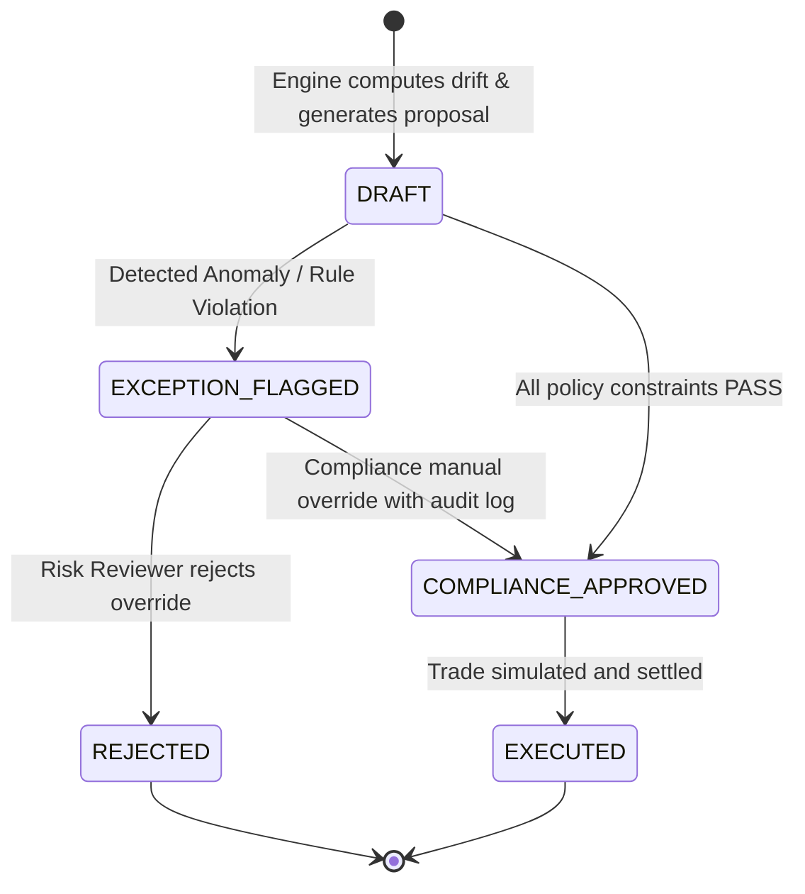

# Data Dictionary: Policy-Constrained Portfolio Rebalancing System

> **Notice & Legal Disclaimer**: Educational and simulation purposes only. Not financial or investment advice.

---

## 1. Overview
This data dictionary defines the complete logical and physical schema for the Policy-Constrained Portfolio Rebalancing Engine. It covers all 10 core entities, bridge tables for many-to-many relationships, event/audit logs for immutable history, deterministic ID formats, data types, units, and validation rules.

---

## 2. Global Conventions & Nomenclature Standards

| Entity | ID Prefix / Pattern | Example ID | Immutability |
| :--- | :--- | :--- | :--- |
| **InvestorProfile** | `INV-{seq:06d}` | `INV-000001` | Immutable |
| **Portfolio** | `PORT-{investor_id}-{sub_seq:02d}` | `PORT-INV-000001-01` | Immutable |
| **Instrument** | `INS-{seq:06d}` | `INS-000001` | Immutable |
| **Holding** | `HOLD-{portfolio_id}-{instrument_id}` | `HOLD-PORT-INV-000001-01-INS-000001` | Immutable PK |
| **MarketPrice** | `PRC-{seq:08d}` | `PRC-00000001` | Immutable |
| **TargetAllocation** | `TGT-{portfolio_id}-{instrument_id}` | `TGT-PORT-INV-000001-01-INS-000001` | Immutable PK |
| **RebalanceProposal** | `RB-{year}-{seq:06d}` | `RB-2026-000001` | Immutable |
| **Trade** | `TRD-{year}-{seq:06d}` | `TRD-2026-000001` | Immutable |
| **FeeSchedule** | `FEE-{seq:06d}` | `FEE-000001` | Immutable |
| **Constraint** | `CST-{seq:06d}` | `CST-000001` | Immutable |
| **PortfolioConstraint** | `PC-{portfolio_id}-{constraint_id}` | `PC-PORT-INV-000001-01-CST-000001` | Bridge PK |
| **ProposalEventLog** | `EVT-{seq:08d}` | `EVT-00000001` | Append-only |

---

## 3. Entity Data Dictionaries

### 3.1. Entity: `InvestorProfile`
Stores the legal account holder details, investment objectives, and risk appetite.

| Field Name | Type | Req/Opt | Allowed Values | Units | Uniqueness | Validation Rule |
| :--- | :--- | :--- | :--- | :--- | :--- | :--- |
| `investor_id` | `VARCHAR(32)` | Required | `INV-[0-9]{6}` | Identifier | Primary Key | Must match regex `^INV-\d{6}$` |
| `full_name` | `VARCHAR(100)` | Required | Non-empty text | N/A | Non-unique | Length between 2 and 100 characters |
| `email` | `VARCHAR(120)` | Required | Valid email string | N/A | Unique | Standard RFC 5322 email regex |
| `risk_tolerance` | `VARCHAR(20)` | Required | `CONSERVATIVE`, `MODERATE`, `GROWTH`, `AGGRESSIVE` | Enum | Non-unique | Must be one of the 4 allowed risk categories |
| `tax_status` | `VARCHAR(20)` | Required | `TAXABLE`, `TAX_EXEMPT`, `TAX_DEFERRED` | Enum | Non-unique | Must be valid tax classification |
| `onboarding_date`| `DATE` | Required | ISO 8601 (`YYYY-MM-DD`) | Date | Non-unique | Must be $\le$ current date and $\ge 2015-01-01$ |
| `kyc_status` | `VARCHAR(20)` | Required | `VERIFIED`, `PENDING`, `EXPIRED` | Enum | Non-unique | Default `VERIFIED` |
| `created_at` | `TIMESTAMP` | Required | ISO 8601 Timestamp | UTC Timestamp | Non-unique | `DEFAULT CURRENT_TIMESTAMP` |

---

### 3.2. Entity: `Portfolio`
Represents an individual investment account owned by an investor.

| Field Name | Type | Req/Opt | Allowed Values | Units | Uniqueness | Validation Rule |
| :--- | :--- | :--- | :--- | :--- | :--- | :--- |
| `portfolio_id` | `VARCHAR(64)` | Required | `PORT-INV-[0-9]{6}-[0-9]{2}` | Identifier | Primary Key | Must match regex `^PORT-INV-\d{6}-\d{2}$` |
| `investor_id` | `VARCHAR(32)` | Required | Existing `InvestorProfile.investor_id` | Foreign Key | Non-unique | Must exist in `InvestorProfile` table |
| `portfolio_type` | `VARCHAR(30)` | Required | `INDIVIDUAL_TAXABLE`, `ROTH_IRA`, `TRADITIONAL_IRA`, `TRUST` | Enum | Non-unique | Must match allowed portfolio types |
| `base_currency` | `CHAR(3)` | Required | `USD` | ISO 4217 | Non-unique | Must be standard 3-letter currency code |
| `cash_balance` | `DECIMAL(18, 4)` | Required | Numeric $\ge 0.0000$ | USD | Non-unique | Cash cannot be negative unless margin approved |
| `fee_schedule_id`| `VARCHAR(32)` | Required | Existing `FeeSchedule.fee_schedule_id` | Foreign Key | Non-unique | Must exist in `FeeSchedule` table |
| `rebalance_threshold` | `DECIMAL(6, 4)` | Required | $0.0100 \le x \le 0.2000$ (1% to 20%) | Ratio | Non-unique | Drift threshold to trigger rebalance recommendation |
| `status` | `VARCHAR(20)` | Required | `ACTIVE`, `FROZEN`, `CLOSED` | Enum | Non-unique | Default `ACTIVE` |
| `created_at` | `TIMESTAMP` | Required | ISO 8601 Timestamp | UTC Timestamp | Non-unique | Must be $\ge$ Investor `onboarding_date` |

---

### 3.3. Entity: `Instrument`
Master table of tradable financial assets.

| Field Name | Type | Req/Opt | Allowed Values | Units | Uniqueness | Validation Rule |
| :--- | :--- | :--- | :--- | :--- | :--- | :--- |
| `instrument_id` | `VARCHAR(32)` | Required | `INS-[0-9]{6}` | Identifier | Primary Key | Must match regex `^INS-\d{6}$` |
| `symbol` | `VARCHAR(16)` | Required | Uppercase alpha (e.g. `AAPL`, `SPY`, `BND`) | Ticker | Unique | `^[A-Z]{1,10}$` |
| `name` | `VARCHAR(120)` | Required | Non-empty string | N/A | Non-unique | Name of asset |
| `asset_class` | `VARCHAR(30)` | Required | `EQUITY`, `FIXED_INCOME`, `COMMODITY`, `REAL_ESTATE`, `CASH_EQUIVALENT` | Enum | Non-unique | Must belong to one of 5 canonical asset classes |
| `sector` | `VARCHAR(40)` | Optional | `TECHNOLOGY`, `HEALTHCARE`, `FINANCIALS`, `ENERGY`, `GOVERNMENT`, `BROAD_MARKET` | Enum | Non-unique | Sector classification |
| `liquidity_tier` | `VARCHAR(20)` | Required | `HIGH`, `MEDIUM`, `LOW` | Enum | Non-unique | Determines max daily trading volume restriction |
| `lot_size` | `INT` | Required | $\ge 1$ (usually 1 for whole shares) | Shares | Non-unique | Trade quantity must be an integer multiple of lot size |
| `is_restricted` | `BOOLEAN` | Required | `TRUE`, `FALSE` | Flag | Non-unique | Default `FALSE` |
| `is_active` | `BOOLEAN` | Required | `TRUE`, `FALSE` | Flag | Non-unique | Default `TRUE` |

---

### 3.4. Entity: `MarketPrice`
Daily historical and current pricing records for each instrument.

| Field Name | Type | Req/Opt | Allowed Values | Units | Uniqueness | Validation Rule |
| :--- | :--- | :--- | :--- | :--- | :--- | :--- |
| `price_id` | `VARCHAR(32)` | Required | `PRC-[0-9]{8}` | Identifier | Primary Key | Must match regex `^PRC-\d{8}$` |
| `instrument_id` | `VARCHAR(32)` | Required | Existing `Instrument.instrument_id` | Foreign Key | Non-unique | Must exist in `Instrument` |
| `price_date` | `DATE` | Required | ISO 8601 (`YYYY-MM-DD`) | Trading Day | Composite Unique (`instrument_id`, `price_date`) | Cannot be future date |
| `close_price` | `DECIMAL(18, 4)` | Required | $> 0.0000$ | USD / Share | Non-unique | Must be strictly positive |
| `bid_price` | `DECIMAL(18, 4)` | Required | $> 0.0000$ and $\le$ `ask_price` | USD / Share | Non-unique | Bid cannot exceed Ask |
| `ask_price` | `DECIMAL(18, 4)` | Required | $\ge$ `bid_price` | USD / Share | Non-unique | Ask must be $\ge$ Bid |
| `volume` | `BIGINT` | Required | $\ge 0$ | Shares Traded | Non-unique | Daily trading volume |
| `is_stale_flag` | `BOOLEAN` | Required | `TRUE`, `FALSE` | Flag | Non-unique | If price age $> 1$ business day, flag must be `TRUE` |

---

### 3.5. Entity: `TargetAllocation`
Defines the target model percentage for each asset in a portfolio.

| Field Name | Type | Req/Opt | Allowed Values | Units | Uniqueness | Validation Rule |
| :--- | :--- | :--- | :--- | :--- | :--- | :--- |
| `target_id` | `VARCHAR(64)` | Required | `TGT-{portfolio_id}-{instrument_id}` | Identifier | Primary Key | Composite deterministic ID |
| `portfolio_id` | `VARCHAR(64)` | Required | Existing `Portfolio.portfolio_id` | Foreign Key | Non-unique | Must exist in `Portfolio` |
| `instrument_id` | `VARCHAR(32)` | Required | Existing `Instrument.instrument_id` | Foreign Key | Non-unique | Must exist in `Instrument` |
| `target_weight` | `DECIMAL(6, 4)` | Required | $0.0000 < x \le 1.0000$ | Decimal Weight | Non-unique | Sum of weights across portfolio must equal $1.0000 \pm 0.0001$ |
| `tolerance_band` | `DECIMAL(6, 4)` | Required | $0.0050 \le x \le 0.1000$ (0.5% to 10%) | Ratio | Non-unique | Max allowable drift before rebalance |
| `effective_date` | `DATE` | Required | ISO 8601 (`YYYY-MM-DD`) | Date | Non-unique | Activation date of target allocation |
| `expiry_date` | `DATE` | Optional | ISO 8601 or `NULL` | Date | Non-unique | If set, must be $>$ `effective_date` |
| `is_active` | `BOOLEAN` | Required | `TRUE`, `FALSE` | Flag | Non-unique | Default `TRUE` |

---

### 3.6. Entity: `Holding`
The current asset positions held in a portfolio as of a given valuation date.

| Field Name | Type | Req/Opt | Allowed Values | Units | Uniqueness | Validation Rule |
| :--- | :--- | :--- | :--- | :--- | :--- | :--- |
| `holding_id` | `VARCHAR(80)` | Required | `HOLD-{portfolio_id}-{instrument_id}` | Identifier | Primary Key | Composite deterministic ID |
| `portfolio_id` | `VARCHAR(64)` | Required | Existing `Portfolio.portfolio_id` | Foreign Key | Non-unique | Must exist in `Portfolio` |
| `instrument_id` | `VARCHAR(32)` | Required | Existing `Instrument.instrument_id` | Foreign Key | Non-unique | Must exist in `Instrument` |
| `quantity` | `DECIMAL(18, 4)` | Required | $\ge 0.0000$ | Shares / Units | Non-unique | Long-only; cannot be negative |
| `cost_basis_per_share`| `DECIMAL(18, 4)` | Required | $> 0.0000$ | USD / Share | Non-unique | Historical purchase price average |
| `as_of_date` | `DATE` | Required | ISO 8601 (`YYYY-MM-DD`) | Date | Non-unique | Valuation snapshot date |
| `last_updated_at`| `TIMESTAMP` | Required | ISO 8601 Timestamp | UTC Timestamp | Non-unique | `DEFAULT CURRENT_TIMESTAMP` |

---

### 3.7. Entity: `FeeSchedule`
Governs transaction fee calculation policies.

| Field Name | Type | Req/Opt | Allowed Values | Units | Uniqueness | Validation Rule |
| :--- | :--- | :--- | :--- | :--- | :--- | :--- |
| `fee_schedule_id`| `VARCHAR(32)` | Required | `FEE-[0-9]{6}` | Identifier | Primary Key | Must match regex `^FEE-\d{6}$` |
| `name` | `VARCHAR(60)` | Required | Non-empty string (e.g. `STANDARD_TIERED`) | N/A | Unique | Descriptive name |
| `fee_type` | `VARCHAR(20)` | Required | `FLAT`, `BPS_NOTIONAL`, `TIERED` | Enum | Non-unique | Fee calculation model |
| `flat_fee` | `DECIMAL(10, 4)` | Required | $\ge 0.0000$ | USD | Non-unique | Flat fee per executed trade |
| `bps_rate` | `DECIMAL(8, 4)` | Required | $\ge 0.0000$ | Basis points ($1 \text{ bps} = 0.0001$) | Non-unique | Variable fee on trade notional |
| `min_fee` | `DECIMAL(10, 4)` | Required | $\ge 0.0000$ | USD | Non-unique | Minimum fee cap |
| `max_fee` | `DECIMAL(10, 4)` | Optional | $\ge$ `min_fee` or `NULL` | USD | Non-unique | Maximum fee ceiling per trade |

---

### 3.8. Entity: `Constraint`
Defines operational, regulatory, and policy boundaries for rebalancing.

| Field Name | Type | Req/Opt | Allowed Values | Units | Uniqueness | Validation Rule |
| :--- | :--- | :--- | :--- | :--- | :--- | :--- |
| `constraint_id` | `VARCHAR(32)` | Required | `CST-[0-9]{6}` | Identifier | Primary Key | Must match regex `^CST-\d{6}$` |
| `constraint_name`| `VARCHAR(80)` | Required | Non-empty text | N/A | Unique | Descriptive policy name |
| `constraint_type`| `VARCHAR(40)` | Required | `MIN_TRADE_SIZE`, `EXCLUDED_INSTRUMENT`, `MAX_CASH_DRAG`, `NO_SHORT_SELLING` | Enum | Non-unique | Must belong to defined policy enum |
| `target_scope` | `VARCHAR(20)` | Required | `PORTFOLIO`, `INSTRUMENT`, `GLOBAL` | Enum | Non-unique | Scope of rule application |
| `parameters_json`| `JSON` / `TEXT` | Required | Valid JSON string with parameter schema | JSON | Non-unique | E.g. `{"min_usd": 100.0, "restricted_tickers": ["INS-000421"]}` |
| `is_mandatory` | `BOOLEAN` | Required | `TRUE`, `FALSE` | Flag | Non-unique | If `TRUE`, violation causes hard rejection |

---

### 3.9. Entity: `PortfolioConstraint` (Bridge Table)
Many-to-Many bridge table connecting Portfolios to active Constraints.

| Field Name | Type | Req/Opt | Allowed Values | Units | Uniqueness | Validation Rule |
| :--- | :--- | :--- | :--- | :--- | :--- | :--- |
| `bridge_id` | `VARCHAR(96)` | Required | `PC-{portfolio_id}-{constraint_id}` | Identifier | Primary Key | Composite deterministic ID |
| `portfolio_id` | `VARCHAR(64)` | Required | Existing `Portfolio.portfolio_id` | Foreign Key | Non-unique | Must exist in `Portfolio` |
| `constraint_id` | `VARCHAR(32)` | Required | Existing `Constraint.constraint_id` | Foreign Key | Non-unique | Must exist in `Constraint` |
| `is_active` | `BOOLEAN` | Required | `TRUE`, `FALSE` | Flag | Non-unique | Default `TRUE` |
| `created_at` | `TIMESTAMP` | Required | ISO 8601 Timestamp | UTC Timestamp | Non-unique | Timestamp of assignment |

---

### 3.10. Entity: `RebalanceProposal`
The formal proposal generated by the engine containing proposed trades and simulated outcomes.

| Field Name | Type | Req/Opt | Allowed Values | Units | Uniqueness | Validation Rule |
| :--- | :--- | :--- | :--- | :--- | :--- | :--- |
| `proposal_id` | `VARCHAR(32)` | Required | `RB-{year}-[0-9]{6}` | Identifier | Primary Key | Must match regex `^RB-\d{4}-\d{6}$` |
| `portfolio_id` | `VARCHAR(64)` | Required | Existing `Portfolio.portfolio_id` | Foreign Key | Non-unique | Must exist in `Portfolio` |
| `proposal_date` | `DATE` | Required | ISO 8601 (`YYYY-MM-DD`) | Date | Non-unique | Generation date |
| `pre_rebalance_value` | `DECIMAL(18, 4)` | Required | $> 0.0000$ | USD | Non-unique | $\sum (Q_i \cdot P_i) + \text{Cash}$ |
| `post_rebalance_value`| `DECIMAL(18, 4)` | Required | $> 0.0000$ | USD | Non-unique | Pre-value minus total estimated fees |
| `pre_drift_rmse` | `DECIMAL(8, 6)` | Required | $\ge 0.000000$ | RMSE Ratio | Non-unique | $\sqrt{\frac{1}{N}\sum(w_{i,\text{pre}} - w_i^*)^2}$ |
| `post_drift_rmse`| `DECIMAL(8, 6)` | Required | $\ge 0.000000$ | RMSE Ratio | Non-unique | Must be $<$ `pre_drift_rmse` unless blocked |
| `total_turnover` | `DECIMAL(18, 4)` | Required | $\ge 0.0000$ | USD | Non-unique | $\frac{1}{2} \sum |\text{Trade Notional}|$ |
| `estimated_fees` | `DECIMAL(10, 4)` | Required | $\ge 0.0000$ | USD | Non-unique | Sum of estimated fees across all trades |
| `residual_cash` | `DECIMAL(18, 4)` | Required | $\ge 0.0000$ | USD | Non-unique | Simulated post-trade cash balance |
| `status` | `VARCHAR(30)` | Required | `DRAFT`, `COMPLIANCE_APPROVED`, `REJECTED`, `EXECUTED`, `EXCEPTION_FLAGGED` | Enum | Non-unique | Lifecycle state machine |
| `decision_code` | `VARCHAR(50)` | Required | `APPROVED`, `DRIFT_WITHIN_TOLERANCE`, `REJECTED_EXCLUDED_ASSET`, `REJECTED_WEIGHT_SUM`, `REJECTED_OVERSOLD`, `REJECTED_CASH_DEFICIT` | Enum | Non-unique | Explains system decision |
| `created_at` | `TIMESTAMP` | Required | ISO 8601 Timestamp | UTC Timestamp | Non-unique | Creation time |

---

### 3.11. Entity: `Trade`
Individual proposed or executed buy/sell orders belonging to a Rebalance Proposal.

| Field Name | Type | Req/Opt | Allowed Values | Units | Uniqueness | Validation Rule |
| :--- | :--- | :--- | :--- | :--- | :--- | :--- |
| `trade_id` | `VARCHAR(32)` | Required | `TRD-{year}-[0-9]{6}` | Identifier | Primary Key | Must match regex `^TRD-\d{4}-\d{6}$` |
| `proposal_id` | `VARCHAR(32)` | Required | Existing `RebalanceProposal.proposal_id` | Foreign Key | Non-unique | Must exist in `RebalanceProposal` |
| `instrument_id` | `VARCHAR(32)` | Required | Existing `Instrument.instrument_id` | Foreign Key | Non-unique | Must exist in `Instrument` |
| `action` | `VARCHAR(10)` | Required | `BUY`, `SELL`, `HOLD` | Enum | Non-unique | Recommended trading action |
| `quantity` | `DECIMAL(18, 4)` | Required | $\ge 0.0000$ | Shares / Lots | Non-unique | If action is `HOLD`, quantity must be 0 |
| `price` | `DECIMAL(18, 4)` | Required | $> 0.0000$ | USD / Share | Non-unique | Market price as of valuation date |
| `notional` | `DECIMAL(18, 4)` | Required | $\ge 0.0000$ | USD | Non-unique | Calculated as `quantity * price` |
| `estimated_fee` | `DECIMAL(10, 4)` | Required | $\ge 0.0000$ | USD | Non-unique | Calculated via `FeeSchedule` |
| `compliance_status` | `VARCHAR(20)` | Required | `PASS`, `FAIL_RESTRICTED`, `FAIL_MIN_SIZE`, `FAIL_OVERSELL` | Enum | Non-unique | Compliance check result |
| `status` | `VARCHAR(20)` | Required | `PROPOSED`, `SUBMITTED`, `FILLED`, `CANCELLED` | Enum | Non-unique | Trade lifecycle status |

---

### 3.12. Entity: `ProposalEventLog` (Audit & Traceability)
Immutable event journal tracking state transitions across rebalance proposals.

| Field Name | Type | Req/Opt | Allowed Values | Units | Uniqueness | Validation Rule |
| :--- | :--- | :--- | :--- | :--- | :--- | :--- |
| `event_id` | `VARCHAR(32)` | Required | `EVT-[0-9]{8}` | Identifier | Primary Key | Auto-incrementing deterministic ID |
| `proposal_id` | `VARCHAR(32)` | Required | Existing `RebalanceProposal.proposal_id` | Foreign Key | Non-unique | Must exist in `RebalanceProposal` |
| `from_state` | `VARCHAR(30)` | Required | Lifecycle state enum or `NONE` | Enum | Non-unique | Prior state |
| `to_state` | `VARCHAR(30)` | Required | Lifecycle state enum | Enum | Non-unique | New transitioned state |
| `actor_role` | `VARCHAR(30)` | Required | `SYSTEM`, `OPERATIONS_ANALYST`, `COMPLIANCE_REVIEWER`, `CUSTOMER` | Enum | Non-unique | Actor who triggered transition |
| `notes` | `TEXT` | Optional | Reason text / audit comment | N/A | Non-unique | Free-form explanation |
| `occurred_at` | `TIMESTAMP` | Required | ISO 8601 Timestamp | UTC Timestamp | Non-unique | Monotonically increasing |

---

## 4. Lifecycle State Transitions

