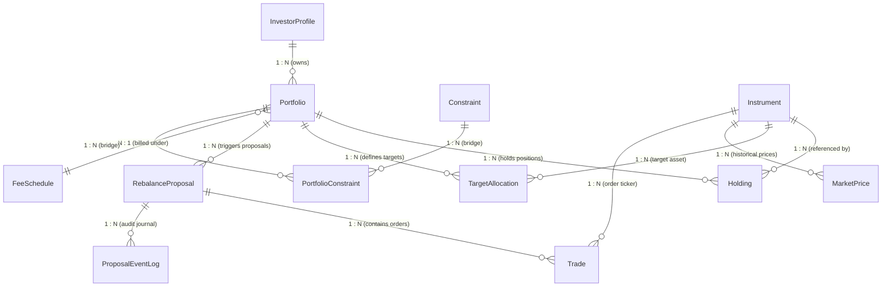

# Relational Schema Specification

## 1. Relational Architecture & Cardinality

The system consists of 10 primary entities, 1 bridge table for Many-to-Many relationships, and 1 immutable audit event ledger.



### Cardinality Summary
1. `InvestorProfile` $\rightarrow$ `Portfolio`: **1 : N** (One investor may hold multiple taxable or retirement accounts).
2. `Portfolio` $\rightarrow$ `Holding`: **1 : N** (A portfolio holds multiple asset positions).
3. `Instrument` $\rightarrow$ `Holding`: **1 : N** (The same stock or bond can be held across multiple portfolios).
4. `Portfolio` $\rightarrow$ `TargetAllocation`: **1 : N** (A portfolio defines target weights for multiple instruments).
5. `Instrument` $\rightarrow$ `MarketPrice`: **1 : N** (An instrument has 250 daily price records).
6. `Portfolio` $\rightarrow$ `Constraint`: **N : M** (Resolved via bridge table `PortfolioConstraint`).
7. `FeeSchedule` $\rightarrow$ `Portfolio`: **1 : N** (One fee schedule applies to many portfolios).
8. `Portfolio` $\rightarrow$ `RebalanceProposal`: **1 : N** (A portfolio generates rebalance proposals over time).
9. `RebalanceProposal` $\rightarrow$ `Trade`: **1 : N** (A rebalance proposal contains 0 or more trade orders).
10. `RebalanceProposal` $\rightarrow$ `ProposalEventLog`: **1 : N** (Append-only audit trail of state transitions).

---

## 2. MySQL 8.0 DDL Schema (`data/sql/schema_mysql.sql`)

```sql
-- ============================================================================
-- POLICY-CONSTRAINED PORTFOLIO REBALANCING ENGINE
-- Target Dialect: MySQL 8.0+ (InnoDB Engine)
-- Notice: For simulation and educational purposes only.
-- ============================================================================

SET FOREIGN_KEY_CHECKS = 0;
DROP TABLE IF EXISTS proposal_event_log;
DROP TABLE IF EXISTS trade;
DROP TABLE IF EXISTS rebalance_proposal;
DROP TABLE IF EXISTS portfolio_constraint;
DROP TABLE IF EXISTS constraint_policy;
DROP TABLE IF EXISTS holding;
DROP TABLE IF EXISTS target_allocation;
DROP TABLE IF EXISTS market_price;
DROP TABLE IF EXISTS instrument;
DROP TABLE IF EXISTS portfolio;
DROP TABLE IF EXISTS fee_schedule;
DROP TABLE IF EXISTS investor_profile;
SET FOREIGN_KEY_CHECKS = 1;

-- 1. InvestorProfile Table
CREATE TABLE investor_profile (
    investor_id VARCHAR(32) NOT NULL,
    full_name VARCHAR(100) NOT NULL,
    email VARCHAR(120) NOT NULL UNIQUE,
    risk_tolerance ENUM('CONSERVATIVE', 'MODERATE', 'GROWTH', 'AGGRESSIVE') NOT NULL,
    tax_status ENUM('TAXABLE', 'TAX_EXEMPT', 'TAX_DEFERRED') NOT NULL,
    onboarding_date DATE NOT NULL,
    kyc_status ENUM('VERIFIED', 'PENDING', 'EXPIRED') NOT NULL DEFAULT 'VERIFIED',
    created_at TIMESTAMP NOT NULL DEFAULT CURRENT_TIMESTAMP,
    PRIMARY KEY (investor_id)
) ENGINE=InnoDB DEFAULT CHARSET=utf8mb4;

-- 2. FeeSchedule Table
CREATE TABLE fee_schedule (
    fee_schedule_id VARCHAR(32) NOT NULL,
    name VARCHAR(60) NOT NULL UNIQUE,
    fee_type ENUM('FLAT', 'BPS_NOTIONAL', 'TIERED') NOT NULL,
    flat_fee DECIMAL(10, 4) NOT NULL DEFAULT 0.0000,
    bps_rate DECIMAL(8, 4) NOT NULL DEFAULT 0.0000,
    min_fee DECIMAL(10, 4) NOT NULL DEFAULT 0.0000,
    max_fee DECIMAL(10, 4) NULL,
    PRIMARY KEY (fee_schedule_id)
) ENGINE=InnoDB DEFAULT CHARSET=utf8mb4;

-- 3. Portfolio Table
CREATE TABLE portfolio (
    portfolio_id VARCHAR(64) NOT NULL,
    investor_id VARCHAR(32) NOT NULL,
    portfolio_type ENUM('INDIVIDUAL_TAXABLE', 'ROTH_IRA', 'TRADITIONAL_IRA', 'TRUST') NOT NULL,
    base_currency CHAR(3) NOT NULL DEFAULT 'USD',
    cash_balance DECIMAL(18, 4) NOT NULL DEFAULT 0.0000,
    fee_schedule_id VARCHAR(32) NOT NULL,
    rebalance_threshold DECIMAL(6, 4) NOT NULL DEFAULT 0.0500,
    status ENUM('ACTIVE', 'FROZEN', 'CLOSED') NOT NULL DEFAULT 'ACTIVE',
    created_at TIMESTAMP NOT NULL DEFAULT CURRENT_TIMESTAMP,
    PRIMARY KEY (portfolio_id),
    CONSTRAINT fk_portfolio_investor FOREIGN KEY (investor_id) 
        REFERENCES investor_profile(investor_id) ON DELETE RESTRICT ON UPDATE CASCADE,
    CONSTRAINT fk_portfolio_fee FOREIGN KEY (fee_schedule_id) 
        REFERENCES fee_schedule(fee_schedule_id) ON DELETE RESTRICT ON UPDATE CASCADE
) ENGINE=InnoDB DEFAULT CHARSET=utf8mb4;

-- 4. Instrument Table
CREATE TABLE instrument (
    instrument_id VARCHAR(32) NOT NULL,
    symbol VARCHAR(16) NOT NULL UNIQUE,
    name VARCHAR(120) NOT NULL,
    asset_class ENUM('EQUITY', 'FIXED_INCOME', 'COMMODITY', 'REAL_ESTATE', 'CASH_EQUIVALENT') NOT NULL,
    sector VARCHAR(40) NULL,
    liquidity_tier ENUM('HIGH', 'MEDIUM', 'LOW') NOT NULL DEFAULT 'HIGH',
    lot_size INT NOT NULL DEFAULT 1,
    is_restricted BOOLEAN NOT NULL DEFAULT FALSE,
    is_active BOOLEAN NOT NULL DEFAULT TRUE,
    PRIMARY KEY (instrument_id)
) ENGINE=InnoDB DEFAULT CHARSET=utf8mb4;

-- 5. MarketPrice Table
CREATE TABLE market_price (
    price_id VARCHAR(32) NOT NULL,
    instrument_id VARCHAR(32) NOT NULL,
    price_date DATE NOT NULL,
    close_price DECIMAL(18, 4) NOT NULL,
    bid_price DECIMAL(18, 4) NOT NULL,
    ask_price DECIMAL(18, 4) NOT NULL,
    volume BIGINT NOT NULL DEFAULT 0,
    is_stale_flag BOOLEAN NOT NULL DEFAULT FALSE,
    PRIMARY KEY (price_id),
    UNIQUE KEY uq_price_inst_date (instrument_id, price_date),
    CONSTRAINT fk_price_instrument FOREIGN KEY (instrument_id) 
        REFERENCES instrument(instrument_id) ON DELETE RESTRICT ON UPDATE CASCADE
) ENGINE=InnoDB DEFAULT CHARSET=utf8mb4;

-- 6. TargetAllocation Table
CREATE TABLE target_allocation (
    target_id VARCHAR(64) NOT NULL,
    portfolio_id VARCHAR(64) NOT NULL,
    instrument_id VARCHAR(32) NOT NULL,
    target_weight DECIMAL(6, 4) NOT NULL,
    tolerance_band DECIMAL(6, 4) NOT NULL DEFAULT 0.0500,
    effective_date DATE NOT NULL,
    expiry_date DATE NULL,
    is_active BOOLEAN NOT NULL DEFAULT TRUE,
    PRIMARY KEY (target_id),
    UNIQUE KEY uq_target_port_inst (portfolio_id, instrument_id),
    CONSTRAINT fk_target_portfolio FOREIGN KEY (portfolio_id) 
        REFERENCES portfolio(portfolio_id) ON DELETE CASCADE ON UPDATE CASCADE,
    CONSTRAINT fk_target_instrument FOREIGN KEY (instrument_id) 
        REFERENCES instrument(instrument_id) ON DELETE RESTRICT ON UPDATE CASCADE
) ENGINE=InnoDB DEFAULT CHARSET=utf8mb4;

-- 7. Holding Table
CREATE TABLE holding (
    holding_id VARCHAR(80) NOT NULL,
    portfolio_id VARCHAR(64) NOT NULL,
    instrument_id VARCHAR(32) NOT NULL,
    quantity DECIMAL(18, 4) NOT NULL DEFAULT 0.0000,
    cost_basis_per_share DECIMAL(18, 4) NOT NULL,
    as_of_date DATE NOT NULL,
    last_updated_at TIMESTAMP NOT NULL DEFAULT CURRENT_TIMESTAMP ON UPDATE CURRENT_TIMESTAMP,
    PRIMARY KEY (holding_id),
    UNIQUE KEY uq_holding_port_inst (portfolio_id, instrument_id),
    CONSTRAINT fk_holding_portfolio FOREIGN KEY (portfolio_id) 
        REFERENCES portfolio(portfolio_id) ON DELETE CASCADE ON UPDATE CASCADE,
    CONSTRAINT fk_holding_instrument FOREIGN KEY (instrument_id) 
        REFERENCES instrument(instrument_id) ON DELETE RESTRICT ON UPDATE CASCADE
) ENGINE=InnoDB DEFAULT CHARSET=utf8mb4;

-- 8. Constraint Table
CREATE TABLE constraint_policy (
    constraint_id VARCHAR(32) NOT NULL,
    constraint_name VARCHAR(80) NOT NULL UNIQUE,
    constraint_type ENUM('MIN_TRADE_SIZE', 'EXCLUDED_INSTRUMENT', 'MAX_CASH_DRAG', 'NO_SHORT_SELLING') NOT NULL,
    target_scope ENUM('PORTFOLIO', 'INSTRUMENT', 'GLOBAL') NOT NULL,
    parameters_json JSON NOT NULL,
    is_mandatory BOOLEAN NOT NULL DEFAULT TRUE,
    PRIMARY KEY (constraint_id)
) ENGINE=InnoDB DEFAULT CHARSET=utf8mb4;

-- 9. PortfolioConstraint (Bridge Table)
CREATE TABLE portfolio_constraint (
    bridge_id VARCHAR(96) NOT NULL,
    portfolio_id VARCHAR(64) NOT NULL,
    constraint_id VARCHAR(32) NOT NULL,
    is_active BOOLEAN NOT NULL DEFAULT TRUE,
    created_at TIMESTAMP NOT NULL DEFAULT CURRENT_TIMESTAMP,
    PRIMARY KEY (bridge_id),
    UNIQUE KEY uq_port_constraint (portfolio_id, constraint_id),
    CONSTRAINT fk_bridge_portfolio FOREIGN KEY (portfolio_id) 
        REFERENCES portfolio(portfolio_id) ON DELETE CASCADE ON UPDATE CASCADE,
    CONSTRAINT fk_bridge_constraint FOREIGN KEY (constraint_id) 
        REFERENCES constraint_policy(constraint_id) ON DELETE CASCADE ON UPDATE CASCADE
) ENGINE=InnoDB DEFAULT CHARSET=utf8mb4;

-- 10. RebalanceProposal Table
CREATE TABLE rebalance_proposal (
    proposal_id VARCHAR(32) NOT NULL,
    portfolio_id VARCHAR(64) NOT NULL,
    proposal_date DATE NOT NULL,
    pre_rebalance_value DECIMAL(18, 4) NOT NULL,
    post_rebalance_value DECIMAL(18, 4) NOT NULL,
    pre_drift_rmse DECIMAL(8, 6) NOT NULL,
    post_drift_rmse DECIMAL(8, 6) NOT NULL,
    total_turnover DECIMAL(18, 4) NOT NULL,
    estimated_fees DECIMAL(10, 4) NOT NULL DEFAULT 0.0000,
    residual_cash DECIMAL(18, 4) NOT NULL,
    status ENUM('DRAFT', 'COMPLIANCE_APPROVED', 'REJECTED', 'EXECUTED', 'EXCEPTION_FLAGGED') NOT NULL,
    decision_code ENUM('APPROVED', 'DRIFT_WITHIN_TOLERANCE', 'REJECTED_EXCLUDED_ASSET', 'REJECTED_WEIGHT_SUM', 'REJECTED_OVERSOLD', 'REJECTED_CASH_DEFICIT') NOT NULL,
    created_at TIMESTAMP NOT NULL DEFAULT CURRENT_TIMESTAMP,
    PRIMARY KEY (proposal_id),
    CONSTRAINT fk_proposal_portfolio FOREIGN KEY (portfolio_id) 
        REFERENCES portfolio(portfolio_id) ON DELETE CASCADE ON UPDATE CASCADE
) ENGINE=InnoDB DEFAULT CHARSET=utf8mb4;

-- 11. Trade Table
CREATE TABLE trade (
    trade_id VARCHAR(32) NOT NULL,
    proposal_id VARCHAR(32) NOT NULL,
    instrument_id VARCHAR(32) NOT NULL,
    action ENUM('BUY', 'SELL', 'HOLD') NOT NULL,
    quantity DECIMAL(18, 4) NOT NULL,
    price DECIMAL(18, 4) NOT NULL,
    notional DECIMAL(18, 4) NOT NULL,
    estimated_fee DECIMAL(10, 4) NOT NULL DEFAULT 0.0000,
    compliance_status ENUM('PASS', 'FAIL_RESTRICTED', 'FAIL_MIN_SIZE', 'FAIL_OVERSELL') NOT NULL DEFAULT 'PASS',
    status ENUM('PROPOSED', 'SUBMITTED', 'FILLED', 'CANCELLED') NOT NULL DEFAULT 'PROPOSED',
    PRIMARY KEY (trade_id),
    CONSTRAINT fk_trade_proposal FOREIGN KEY (proposal_id) 
        REFERENCES rebalance_proposal(proposal_id) ON DELETE CASCADE ON UPDATE CASCADE,
    CONSTRAINT fk_trade_instrument FOREIGN KEY (instrument_id) 
        REFERENCES instrument(instrument_id) ON DELETE RESTRICT ON UPDATE CASCADE
) ENGINE=InnoDB DEFAULT CHARSET=utf8mb4;

-- 12. ProposalEventLog Table (Audit Journal)
CREATE TABLE proposal_event_log (
    event_id VARCHAR(32) NOT NULL,
    proposal_id VARCHAR(32) NOT NULL,
    from_state VARCHAR(30) NOT NULL,
    to_state VARCHAR(30) NOT NULL,
    actor_role ENUM('SYSTEM', 'OPERATIONS_ANALYST', 'COMPLIANCE_REVIEWER', 'CUSTOMER') NOT NULL,
    notes TEXT NULL,
    occurred_at TIMESTAMP NOT NULL DEFAULT CURRENT_TIMESTAMP,
    PRIMARY KEY (event_id),
    CONSTRAINT fk_event_proposal FOREIGN KEY (proposal_id) 
        REFERENCES rebalance_proposal(proposal_id) ON DELETE CASCADE ON UPDATE CASCADE
) ENGINE=InnoDB DEFAULT CHARSET=utf8mb4;
```
